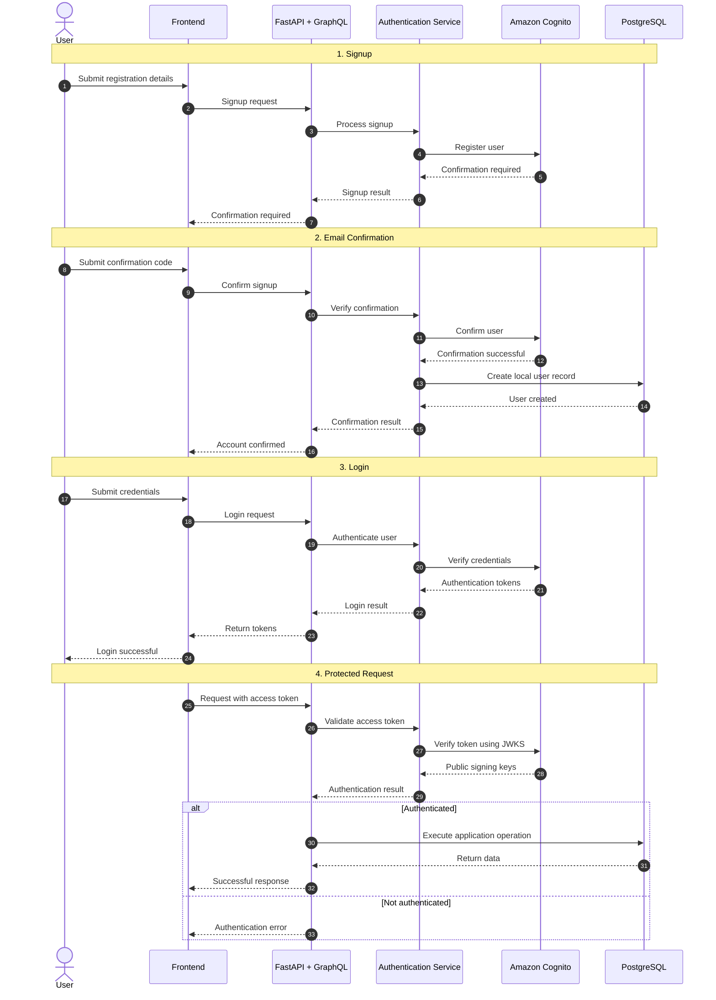
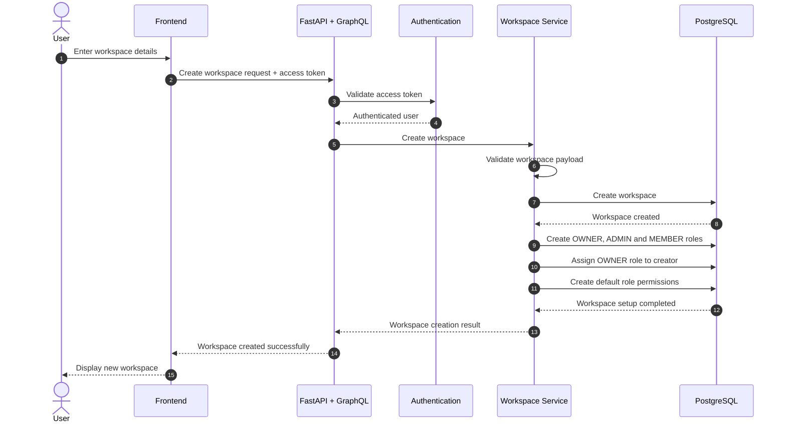

# ClickUp Clone — Backend

A workspace-based project and task management backend built with **FastAPI, Strawberry GraphQL, PostgreSQL, and SQLAlchemy's async ORM**. Amazon Cognito handles user authentication, while PostgreSQL stores application users, workspaces, memberships, roles, permissions, tasks, tags, comments, invitations, and activity history.

> **Project scope:** This repository contains the backend API. It does not currently include a frontend, Docker Compose configuration, automated test suite, or deployment manifests.

## Contents

- [Overview](#overview)
- [Features](#features)
- [Technology stack](#technology-stack)
- [Architecture](#architecture)
- [Project structure](#project-structure)
- [Authentication and authorization](#authentication-and-authorization)
- [Payload validation](#payload-validation)
- [Domain model](#domain-model)
- [Getting started](#getting-started)
- [Database migrations](#database-migrations)
- [GraphQL API](#graphql-api)
- [Code quality](#code-quality)
- [Configuration](#configuration)
- [Operational notes](#operational-notes)
- [License](#license)

## Overview

The application organizes collaboration around workspaces. A workspace has members and workspace-scoped roles; members collaborate on tasks, assign work, add tags and comments, and review task activity.

The codebase follows a **modular monolith** architecture. Business capabilities are grouped under `app/modules`, while shared application infrastructure—configuration, database sessions, logging, middleware, and GraphQL schema composition—is kept in dedicated packages.

## Features

### Authentication and user profiles

- Sign up, confirm registration, and resend Cognito confirmation codes.
- Authenticate through Amazon Cognito and handle token refresh and sign-out flows.
- Verify Cognito access-token signatures using the User Pool JWKS endpoint.
- Validate token issuer, expiry, token use, and app-client ID.
- Map the Cognito subject (`sub`) to a local application user.
- Reject tokens issued before a user's `tokens_valid_after` timestamp.
- Read the authenticated user's information and update profile data.

### Workspaces and membership

- Create workspaces with globally unique slugs.
- Provision the `OWNER`, `ADMIN`, and `MEMBER` roles when a workspace is created.
- Assign the workspace creator the `OWNER` role.
- Read and update workspace information.
- Soft-delete workspaces.
- Invite users by email with a selected role.
- Accept, decline, revoke, and resend invitations.
- Read workspace members, update member roles, and remove members.
- Protect owner membership from ordinary member role-change and removal operations.

Invitation records store a hash of the invitation token rather than the raw token and include an expiry timestamp. Invitations currently expire after seven days.

### Role-based access control (RBAC)

- Maintain a permission catalogue using keys such as `workspace.read`, `members.invite`, and `tasks.assign`.
- Map permissions to roles through the `role_permissions` table.
- Seed permission records and provision role policies during workspace creation.
- Check workspace membership and the required permission before protected service operations.
- Apply permission checks through the reusable `@require_permission(...)` decorator on protected service methods.

The permission catalogue and default role policies are defined in:

- `app/modules/authorization/permissions.py`
- `app/modules/authorization/role_policies.py`
- `app/modules/authorization/decorators.py`

### Tasks, tags, and collaboration

- Create, read, update, and soft-delete tasks.
- Restore soft-deleted tasks.
- Track task status: `TODO`, `IN_PROGRESS`, and `COMPLETED`.
- Track task priority: `LOW`, `MEDIUM`, `HIGH`, and `URGENT`.
- Store task descriptions and optional due dates.
- Support a single level of subtasks and validate parent-task workspace boundaries.
- Assign multiple workspace members to a task and retrieve tasks assigned to the current user.
- Create workspace-scoped tags and associate reusable tags with tasks.
- Create, update, and soft-delete task comments; comment ownership is checked by the service.
- Record task activity for supported task, assignment, tag, and comment operations.
- Store activity change data using PostgreSQL JSONB.

## Technology stack

| Area | Technology |
|---|---|
| Language | Python |
| Web framework | FastAPI |
| ASGI server | Uvicorn |
| API style | GraphQL |
| GraphQL library | Strawberry GraphQL |
| Database | PostgreSQL |
| ORM | SQLAlchemy async ORM |
| PostgreSQL driver | Psycopg 3 |
| Migrations | Alembic |
| Payload validation and settings | Pydantic, Pydantic Settings |
| Authentication | Amazon Cognito |
| AWS SDK | Boto3 |
| JWT verification | PyJWT and Cognito JWKS |
| Linting and formatting | Ruff |

Pinned application dependencies are listed in [requirements.txt](requirements.txt). Ruff configuration is maintained in `pyproject.toml`.

## Architecture

The application uses a layered, modular-monolith approach:

| Layer | Responsibility |
|---|---|
| GraphQL queries and mutations | Expose client operations and pass validated inputs to services |
| Schemas | Validate and normalize incoming application payloads with Pydantic |
| Types | Define GraphQL input and output types |
| Services | Apply business rules, validation, and authorization |
| Repositories | Encapsulate SQLAlchemy queries and persistence operations |
| Models | Define database tables and ORM mappings |
| Core and database | Provide configuration, logging, middleware, engine, and session management |

### Request lifecycle

1. A client sends a request to `POST /graphql`, optionally including an access token in the `Authorization: Bearer <token>` header.
2. FastAPI middleware handles request logging and assigns a request ID. CORS middleware applies the configured cross-origin policy.
3. Strawberry's context dependency obtains an asynchronous SQLAlchemy session.
4. If a bearer token is present, the application verifies the Cognito access token and resolves the local user using the token's `sub` claim.
5. The GraphQL context exposes the database session, authenticated claims (when valid), and access token to resolvers.
6. Resolvers validate incoming payloads using the relevant Pydantic schema and delegate business operations to services.
7. Protected service methods run workspace permission checks through the authorization decorator.
8. Services enforce domain rules and use repositories for database operations.
9. The custom GraphQL router formats expected GraphQL errors and logs unexpected exceptions with the request ID.

### Error handling and request logging

- `RequestLoggingMiddleware` provides request-level logging and the `X-Request-ID` response header.
- Centralized logging is configured in `app/core/logging`.
- `CentralizedGraphQLRouter` handles GraphQL errors, returns a generic internal-server-error message for unexpected resolver exceptions, and logs the underlying exception.
- Expected GraphQL errors retain their formatted error information and receive the request ID in their extensions.

## Project structure

The following tree shows the main packages and responsibilities. Repetitive package initializer files are omitted.

```text
ClickUp-Clone/
├── app/
│   ├── core/
│   │   ├── config.py
│   │   ├── database.py
│   │   ├── logging/
│   │   └── middleware/
│   ├── db/
│   │   ├── base.py
│   │   └── session.py
│   ├── graphql/
│   │   ├── error_handler.py
│   │   └── schema.py
│   └── modules/
│       ├── auth/
│       ├── authorization/
│       │   ├── decorators.py
│       │   ├── permissions.py
│       │   └── role_policies.py
│       ├── users/
│       ├── workspaces/
│       │   ├── models/
│       │   ├── mutations/
│       │   ├── queries/
│       │   ├── repositories/
│       │   ├── schemas/
│       │   ├── security/
│       │   └── services/
│       ├── tasks/
│       │   ├── enums/
│       │   ├── models/
│       │   ├── mutations/
│       │   ├── queries/
│       │   ├── repository/
│       │   ├── services/
│       │   └── types/
│       └── tags/
│           ├── models/
│           ├── mutations/
│           ├── queries/
│           ├── repository/
│           ├── services/
│           └── types/
├── migrations/
│   └── versions/
├── alembic.ini
├── main.py
├── pyproject.toml
├── requirements.txt
├── LICENSE
└── .gitignore
```

### Important entry points

| File | Purpose |
|---|---|
| `main.py` | Creates the FastAPI application, configures middleware, mounts GraphQL, and exposes the health endpoint |
| `app/core/config.py` | Loads application settings from environment variables and `.env` |
| `app/db/session.py` | Creates the async SQLAlchemy engine, session factory, and database dependency |
| `app/graphql/schema.py` | Composes module query and mutation classes into the Strawberry schema |
| `app/graphql/error_handler.py` | Implements centralized GraphQL error formatting |
| `app/modules/authorization/decorators.py` | Provides reusable service-level permission enforcement |
| `migrations/env.py` | Connects Alembic to application settings and model metadata |
| `pyproject.toml` | Contains Ruff linting and formatting configuration |

## Authentication and authorization

### Authentication with Cognito

Amazon Cognito is the identity provider. The backend verifies access tokens using the User Pool's JWKS public keys. Token verification checks the signature, issuer, expiry, required claims, `token_use=access`, and configured Cognito app-client ID.

### Authentication flow (high-level)



### Workspace creation flow (high-level)



For authenticated GraphQL operations, send the Cognito **access token**:

```http
Authorization: Bearer <COGNITO_ACCESS_TOKEN>
Content-Type: application/json
```

The application resolves the local user from the verified Cognito `sub` claim. Resolvers use the authentication helper in `app/modules/auth/authorization.py` to require an authenticated user.

### Workspace RBAC

Authorization is scoped to a workspace:

1. Resolve the user's role in the requested workspace.
2. Reject the request if the user is not a workspace member.
3. Check whether the role is mapped to the requested permission.
4. Reject the operation when the permission is not granted.

Default role policies are provisioned for each new workspace.

| Role | Intended access |
|---|---|
| OWNER | Full workspace, member, role/permission, task, comment, and tag access |
| ADMIN | Workspace read, member read/invite, and task, comment, and tag operations |
| MEMBER | Workspace read, task create/read/update, and comment create/read |

The exact permission mapping is defined in `app/modules/authorization/role_policies.py`; use that file as the source of truth.

### Service-level permission decorator

Protected service methods use the reusable `@require_permission(Permission.<KEY>)` decorator. The decorator:

1. Binds the decorated method's arguments by their parameter names.
2. Extracts the `db`, `user_id`, and `workspace_id` values.
3. Calls `AuthorizationService.require_permission(...)` before executing the original method.
4. Stops execution when the user is not a workspace member or lacks the required permission.

This keeps permission enforcement close to the business operation rather than duplicating the same authorization logic in every resolver. Internal helper methods that are not user-facing permission boundaries are not automatically decorated; they are called within the relevant service workflow.

## Payload validation

Pydantic is used as a dedicated validation layer for application payloads. GraphQL types describe the API contract, while Pydantic schemas validate the values passed into business operations.

The workspace schema package currently includes payload models for workspace creation, updates, deletion, ID/slug queries, and membership operations. These schemas use validation features such as:

- UUID parsing for identifiers.
- Required fields, length limits, and string constraints.
- Slug trimming and lowercase normalization.
- Rejection of unexpected fields with `extra="forbid"`.
- Cross-field validation, such as requiring at least one field in a workspace update.

The current implementation is being introduced module by module; the workspace and membership payloads are the initial documented scope. See `app/modules/workspaces/schemas/` for the implemented schemas.

## Domain model

The principal persisted entities include:

| Entity | Purpose |
|---|---|
| Users | Local application identities linked to Cognito subjects |
| User profiles | User display and profile information |
| Workspaces | Collaboration boundaries with unique slugs |
| Workspace members | Associates users with workspaces and roles |
| Roles | Workspace-specific role definitions |
| Permissions | Catalogue of permission keys |
| Role permissions | Maps roles to permissions within a workspace |
| Workspace invitations | Tracks invitees, assigned roles, token hashes, status, and expiry |
| Tasks | Workspace tasks with status, priority, due date, and optional parent task |
| Task assignees | Associates multiple users with tasks |
| Tags and task tags | Reusable workspace tags and task-tag associations |
| Task comments | User-authored task discussion |
| Task history | Task activity records with structured change details |

Invitation status, task status, and task priority use enumerated values. Task activity details are stored as JSONB.

## Getting started

### Prerequisites

- Python version compatible with the pinned packages in `requirements.txt`.
- PostgreSQL.
- An Amazon Cognito User Pool and app client configured for the authentication flows used by the application.
- AWS credentials/configuration for the Cognito operations used by the backend.

### 1. Clone the repository

```bash
git clone https://github.com/Hariprasaath-meyc/ClickUp-Clone.git
cd ClickUp-Clone
```

### 2. Create and activate a virtual environment

**Windows PowerShell**

```powershell
python -m venv .venv
.\.venv\Scripts\Activate.ps1
```

**macOS / Linux**

```bash
python3 -m venv .venv
source .venv/bin/activate
```

### 3. Install dependencies

```bash
python -m pip install --upgrade pip
pip install -r requirements.txt
pip install pydantic-settings
```

The settings module imports `pydantic-settings`, which is not currently listed in `requirements.txt`; install it explicitly as shown above.

### 4. Configure environment variables

Create a `.env` file in the repository root:

```dotenv
DATABASE_URL=postgresql+psycopg://<db_user>:<db_password>@localhost:5432/<database_name>

AWS_REGION=ap-south-1
COGNITO_CLIENT_ID=<your_cognito_app_client_id>
COGNITO_CLIENT_SECRET=<your_cognito_app_client_secret>
COGNITO_USER_POOL_ID=<your_cognito_user_pool_id>
```

Notes:

- `DATABASE_URL` is required by the application settings.
- `COGNITO_USER_POOL_ID` is required for token verification.
- `AWS_REGION` defaults to `ap-south-1` when omitted.
- `COGNITO_CLIENT_SECRET` is needed when the Cognito app client is configured with a secret.
- Keep `.env` out of version control. Never commit real credentials or secrets.

The database URL must be compatible with SQLAlchemy's async engine and the Psycopg driver.

### 5. Create the PostgreSQL database

Create an empty database matching the name in `DATABASE_URL`. For example:

```sql
CREATE DATABASE clickup_clone;
```

### 6. Apply migrations

```bash
alembic upgrade head
```

### 7. Start the application

```bash
uvicorn main:app --reload
```

The development server uses the default Uvicorn address unless configured otherwise:

- GraphQL API: http://127.0.0.1:8000/graphql
- Health check: http://127.0.0.1:8000/health

The current CORS configuration in `main.py` allows the Vite development origin `http://localhost:5173`, with POST and OPTIONS methods and the Content-Type and Authorization headers.

## Database migrations

Alembic is configured in `alembic.ini` and `migrations/env.py`. The migration environment imports the ORM models and uses the application's configured database URL and SQLAlchemy metadata.

Common commands:

```bash
# Apply all pending migrations
alembic upgrade head

# Show the current database revision
alembic current

# Show migration history
alembic history

# Generate a migration from model changes
alembic revision --autogenerate -m "describe the schema change"

# Roll back one revision
alembic downgrade -1
```

Review autogenerated migration scripts before applying them, especially when changing enums, foreign keys, constraints, or columns that may contain existing data.

## GraphQL API

The Strawberry schema is composed in `app/graphql/schema.py`. It combines query and mutation classes from the authentication, user, workspace, membership, invitation, task, task-comment, task-history, and tag modules.

The endpoint is:

```text
POST /graphql
```

A simple query available in the schema:

```graphql
query {
  hello
}
```

For authenticated operations, include the Cognito access token in the Authorization header. Consult the relevant module's mutation, query, schema, and type definitions for the exact operation names and input/output fields.

## Code quality

Ruff is configured in `pyproject.toml` with an 88-character line length and Python 3.13 as the target version.

Run the checks from the repository root:

```bash
# Check lint rules
ruff check .

# Check formatting without changing files
ruff format --check .

# Apply formatting
ruff format .
```

## Configuration

| Variable | Required | Description |
|---|---|---|
| `DATABASE_URL` | Yes | Async SQLAlchemy PostgreSQL connection URL using Psycopg |
| `AWS_REGION` | No | Cognito region; defaults to `ap-south-1` |
| `COGNITO_CLIENT_ID` | For token verification | Cognito app-client ID checked against the access token |
| `COGNITO_CLIENT_SECRET` | If app client has a secret | Used by Cognito authentication flows that require a secret hash |
| `COGNITO_USER_POOL_ID` | Yes for token verification | Used to construct the Cognito issuer and JWKS URL |

## Operational notes

- This repository currently contains backend code only; no frontend is included.
- The FastAPI application mounts the GraphQL router at `/graphql` and exposes `/health`.
- The async SQLAlchemy session is provided through the GraphQL context dependency.
- Task and comment deletion use soft-delete behavior in the service/repository layer.
- Task restoration is implemented for soft-deleted tasks.
- Workspace deletion uses soft-delete behavior.
- Workspace creation provisions the default roles, permission mappings, and creator's OWNER membership.
- Pydantic payload schemas and service-level permission decorators are being adopted module by module.
- No Docker Compose configuration, automated test suite, or deployment workflow is present in the current repository tree.
- The current `requirements.txt` does not include `pydantic-settings`, although `app/core/config.py` imports it. Install it explicitly as shown in the setup instructions.

## License

This project is licensed under the **MIT License**. See [LICENSE](LICENSE) for the complete license text.
